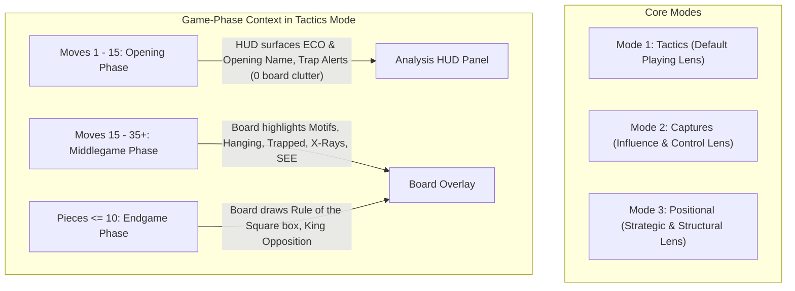

# Chess Analysis Overlay — Master Architecture & Project Plan

## 1. Executive Summary & Vision

**Chess Analysis Overlay** (`chess-analysis-overlay`) is an advanced, non-engine Windows desktop overlay that uses computer vision to recognize chessboards in real time (Chess.com, Lichess, desktop interfaces) and provides concrete tactical, strategic, and geometric intelligence.

### Non-Engine Philosophy
Unlike conventional engines (Stockfish, LCZero, Komodo) that execute deep recursive minimax tree searches to output opaque numerical evaluations (+0.4) and engine moves, this system specializes in **0-ply geometric awareness, concrete material relationships, static exchange evaluations (SEE), and human-meaningful chess concepts**.

---

## 2. Monorepo Subproject Structure

The repository is organized strictly by domain responsibility:

```text
chess-analysis-overlay/
│
├── README.md                          # Comprehensive documentation & beginner quick start
├── PROJECT_PLAN.md                    # Master architectural roadmap & design record
├── requirements.txt                   # python-chess, opencv-python, PySide6, numpy, mss, Pillow
├── install.bat / launch.bat           # One-click automated setup and execution
├── main.py                            # Unified application entry point
│
├── core/                              # Shared Domain Infrastructure
│   ├── board_recognition/             # Screen grabber, template matcher, 1D grid snapper, piece recognition
│   ├── chess_rules/                   # Move validator, transition continuity, dual-check rejector
│   ├── position_representation/       # Coordinate mapper, square-to-pixel transforms, board state
│   └── shared_analysis/               # SEE engine, attack/defense square control maps, piece values
│
├── projects/                          # Specialized Analytical Subprojects
│   ├── chess_capture_visualizer/      # Phase 1: Legal captures, defense rays, square influence
│   ├── chess_tactical_analyzer/       # Phase 2: 0-ply motifs, hanging pieces, trapped pieces, X-rays, blunders
│   ├── chess_opening_analyzer/        # Phase 3 (Planned): ECO detection, variation names, opening traps
│   ├── chess_endgame_analyzer/        # Phase 4 (Planned): Rule of the square, opposition, key squares
│   └── chess_positional_analyzer/     # Phase 5 (Planned): Outposts, pawn structures, open files, bad bishops
│
├── overlay/                           # Unified Presentation Layer
│   ├── rendering/                     # Hardware-accelerated transparent canvas (OverlayWidget)
│   ├── interface/                     # Floating toolbar (ControlBar), floating HUD (HUDPanel), system tray
│   └── configuration/                 # Centralized VisualTheme, persistent settings
│
└── tests/                             # Unified test suite covering all modules
```

---

## 3. Mode Architecture: How Modes Should Work

### The Question: Unified in Tactical Mode vs. Separate Modes?
* **The Problem with "One Mode for Everything":** If opening names, pawn structures, outposts, endgame boxes, capture arrows, and tactical motifs are all drawn simultaneously on the board, the screen turns into an unreadable "spiderweb" of visual pollution.
* **The Problem with "A Separate Mode for Everything":** If the user has to manually click a toolbar button to switch from *Opening Mode* (move 10) to *Tactics Mode* (move 16) to *Endgame Mode* (move 36), the overlay becomes frustrating to use during live blitz or rapid games.

### The Solution: The "Analytical Lens" Model

We establish **Three Core Visual Modes**, augmented by **Game-Phase Contextual Intelligence**:



#### 1. `Mode: Tactics` (The Universal Real-Time Playing Mode)
* **Design:** Zero manual clicking required during a game. The overlay dynamically adapts to the game's natural life cycle:
  * **During the Opening (Moves 1–15):** The floating HUD displays the opening name, ECO code, and flags any known opening traps. **No board arrow pollution is generated.**
  * **During the Middlegame:** Tactical motifs (forks, pins, skewers, trapped pieces, X-ray rays, winning trades, subtle blunders) are rendered on the board and detailed in the HUD.
  * **During the Endgame ($\le 10$ pieces or Queens traded):** Tactical motifs naturally quiet down; the board renders endgame geometry (Rule of the Square bounding box, King opposition line).

#### 2. `Mode: Captures` (The Pure Influence Mode)
* Displays every legal capture for both players, defending arrows, and square control highlights (Blue/Red/Violet). Preserved for players who want to see raw board influence.

#### 3. `Mode: Positional` (Dedicated Strategic Study Mode)
* Designed for slower games, puzzle study, and post-game review when the player wants to evaluate pawn structures without tactical arrows:
  * **Knight Outposts:** Soft green square tints on holes in the enemy camp that enemy pawns can never challenge.
  * **Pawn Weaknesses:** Faint markers on isolated pawns, backward pawns, and doubled pawns.
  * **Open / Semi-Open Files:** Subtle vertical column glow for rooks.
  * **Bad Bishops:** Indicates bishops severely restricted by their own fixed pawns.

---

## 4. Phased Implementation Roadmap

### Phase 5A: `projects/chess_opening_analyzer`
1. **Module Creation:** Create `projects/chess_opening_analyzer/` (`book.py`, `traps.py`, `__init__.py`).
2. **Opening Classification:** Implement compact ECO tree / polyglot opening database mapping FENs to standard ECO codes and names (e.g., `B90: Sicilian Defense, Najdorf Variation`).
3. **Opening Trap Alerts:** Pre-program classic opening trap recognition (Noah's Ark, Fishing Pole, Legall's Mate tension, Elephant Trap).
4. **HUD Integration:** Add an elegant top badge in `HUDPanel` visible during the opening phase (moves 1–15).
5. **Testing:** Unit test opening recognition across major openings (Ruy Lopez, Sicilian, French, Caro-Kann, Queen's Gambit, King's Indian).

### Phase 5B: `projects/chess_endgame_analyzer`
1. **Module Creation:** Create `projects/chess_endgame_analyzer/` (`pawn_endgames.py`, `opposition.py`, `tablebase.py`, `__init__.py`).
2. **Rule of the Square:** Implement mathematical detection of runaway passed pawns in King + Pawn endings; render a subtle dashed square bounding box on the board showing if the defending King is inside the square.
3. **King Opposition Detection:** Detect direct, distant, and diagonal King opposition in K+P vs K endings.
4. **Passed Pawn Classification:** Distinguish protected passed pawns, outside passed pawns, and candidate passers in the HUD.
5. **Testing:** Verify with standard endgame test suites (Dvoretsky / de la Villa positions).

### Phase 5C: `projects/chess_positional_analyzer`
1. **Module Creation:** Create `projects/chess_positional_analyzer/` (`outposts.py`, `pawn_structure.py`, `files.py`, `__init__.py`).
2. **Outpost Detection:** Identify squares on ranks 4–6 that cannot be attacked by enemy pawns and are controlled by friendly pieces (ideal for Knights).
3. **Pawn Structure Evaluation:** Identify isolated pawns, backward pawns, doubled pawns, and pawn chains.
4. **Mode Integration:** Add `Positional` mode toggle to the toolbar (`Ctrl + Alt + P` / toolbar button).
5. **Testing:** Unit test outpost and pawn structure algorithms.

---

## 5. Architectural Quality Standards

1. **Strict 0-Ply Geometric Non-Engine Standard:** No recursive tree searches, no Stockfish / Komodo / LCZero dependencies.
2. **Zero-Tolerance Quality Gate:** 0 errors, 0 warnings across all unit and integration tests.
3. **Visual Cleanliness Guarantee:** Annotations must remain readable, unobtrusive, and center-offset to preserve piece visibility. No redundant alerts for obvious states (e.g. flashing King check).
