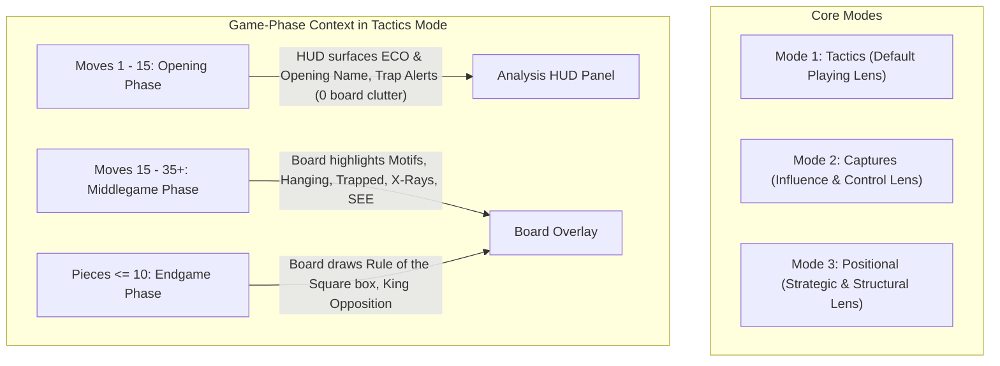

# Chess Analysis Overlay — Master Architecture & Project Plan

## 1. Executive Summary & Vision

**Chess Analysis Overlay** (`chess-analysis-overlay`) is an advanced, non-engine Windows desktop overlay that uses computer vision to recognize chessboards in real time (Chess.com, Lichess, desktop interfaces) and provides concrete tactical, strategic, and geometric intelligence.

### Non-Engine Philosophy
Unlike conventional engines (Stockfish, LCZero, Komodo) that execute deep recursive minimax tree searches to output opaque numerical evaluations (+0.4) and engine moves, this system specializes in **0-ply geometric awareness, concrete material relationships, static exchange evaluations (SEE), and human-meaningful chess concepts**.

---

## 2. Monorepo Subproject Structure

The repository is organized strictly by domain responsibility:

```text
chess-analysis-overlay/
│
├── README.md                          # Comprehensive documentation & beginner quick start
├── PROJECT_PLAN.md                    # Master architectural roadmap & design record
├── requirements.txt                   # python-chess, opencv-python, PySide6, numpy, mss, Pillow
├── install.bat / launch.bat           # One-click automated setup and execution
├── main.py                            # Unified application entry point
│
├── core/                              # Shared Domain Infrastructure
│   ├── board_recognition/             # Screen grabber, template matcher, 1D grid snapper, piece recognition
│   ├── chess_rules/                   # Move validator, transition continuity, dual-check rejector
│   ├── position_representation/       # Coordinate mapper, square-to-pixel transforms, board state
│   └── shared_analysis/               # SEE engine, attack/defense square control maps, piece values
│
├── projects/                          # Specialized Analytical Subprojects
│   ├── chess_capture_visualizer/      # Phase 1: Legal captures, defense rays, square influence
│   └── chess_tactical_analyzer/       # Phase 2-5: Tactical motifs, Openings, Endgames, Positional
│       ├── tactics/                   # Motifs, hanging pieces, trapped pieces, X-rays, blunders
│       ├── openings/                  # Phase 3: ECO detection (A00-E99), variations, opening traps
│       ├── endgames/                  # Phase 4: Rule of the square, opposition, passed pawn classification
│       └── positional/                # Phase 5: Outposts, pawn structures, open files, bad bishops
│
├── overlay/                           # Unified Presentation Layer
│   ├── rendering/                     # Hardware-accelerated transparent canvas (OverlayWidget)
│   ├── interface/                     # Floating toolbar (ControlBar), floating HUD (HUDPanel), system tray
│   └── configuration/                 # Centralized VisualTheme, persistent settings
│
└── tests/                             # Unified test suite covering all modules (148 unit tests)
```

---

## 3. Mode Architecture: The "Analytical Lens" Model

We establish **Three Core Visual Modes**, augmented by **Game-Phase Contextual Intelligence**:



#### 1. `Mode: Tactics` (The Universal Real-Time Playing Mode)
* **Design:** Zero manual clicking required during a game. The overlay dynamically adapts to the game's natural life cycle:
  * **During the Opening (Moves 1–15):** The floating HUD displays the opening name, ECO code, and flags any known opening traps. **No board arrow pollution is generated.**
  * **During the Middlegame:** Tactical motifs (forks, pins, skewers, trapped pieces, X-ray rays, winning trades, subtle blunders) are rendered on the board and detailed in the HUD.
  * **During the Endgame ($\le 10$ pieces or Queens traded):** Tactical motifs naturally quiet down; the board renders endgame geometry (Rule of the Square bounding box, King opposition line).

#### 2. `Mode: Captures` (The Pure Influence Mode)
* Displays every legal capture for both players, defending arrows, and square control highlights (Blue/Red/Violet). Preserved for players who want to see raw board influence.

#### 3. `Mode: Positional` (Dedicated Strategic Study Mode)
* Designed for slower games, puzzle study, and post-game review when the player wants to evaluate pawn structures without tactical arrows:
  * **Knight Outposts:** Soft green square tints on holes in the enemy camp that enemy pawns can never challenge.
  * **Pawn Weaknesses:** Amber corner brackets on isolated pawns, backward pawns, and doubled pawns.
  * **Open / Semi-Open Files:** Subtle sky-blue vertical column glow for rooks.
  * **Bad Bishops:** Dash-dot border highlighting bishops severely restricted by their own fixed pawns.
  * **Space Advantage:** Ranks 4–5 territory metrics displayed live on the HUD.

---

## 4. Implementation Status (100% Complete)

| Component | Status | Verification |
|---|:---:|---|
| **Umbrella Monorepo Structure** | Completed | 148 automated unit tests pass |
| **Opening Book & ECO Classification** | Completed | Major openings & 5 opening traps verified |
| **Endgame Rule of the Square & Opposition** | Completed | Bounding box & king opposition geometry verified |
| **Positional Structure & Outposts** | Completed | Outposts, pawn structures, bad bishops, space control verified |
| **3-Mode Cycling Toolbar & Hotkeys** | Completed | `Tactics` -> `Captures` -> `Positional` with `Ctrl+Alt+P` verified |
| **Hardware DWM Screen Capture Exclusion** | Completed | Windows DWM exclusion verified across all widgets |

---

## 5. Architectural Quality Standards

1. **Strict 0-Ply Geometric Non-Engine Standard:** No recursive tree searches, no Stockfish / Komodo / LCZero dependencies.
2. **Zero-Tolerance Quality Gate:** 0 errors, 0 warnings across all 148 unit and integration tests.
3. **Visual Cleanliness Guarantee:** Annotations remain readable, unobtrusive, and center-offset to preserve piece visibility. No redundant alerts for obvious states.
